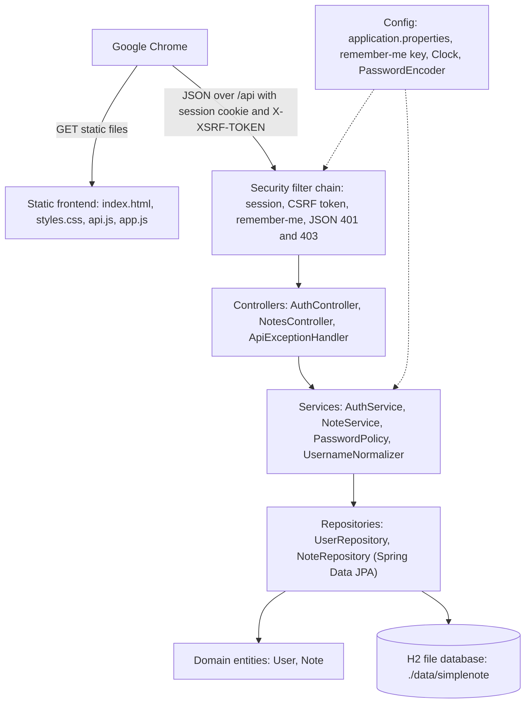
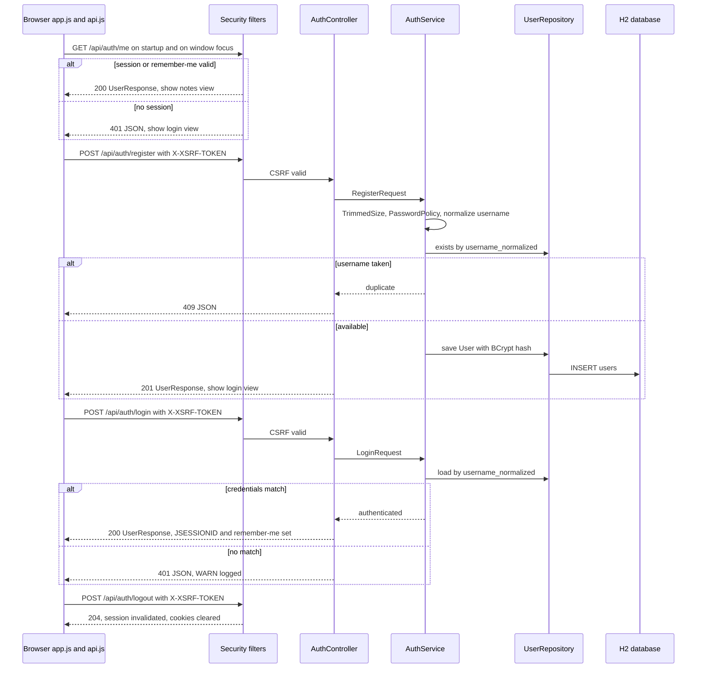
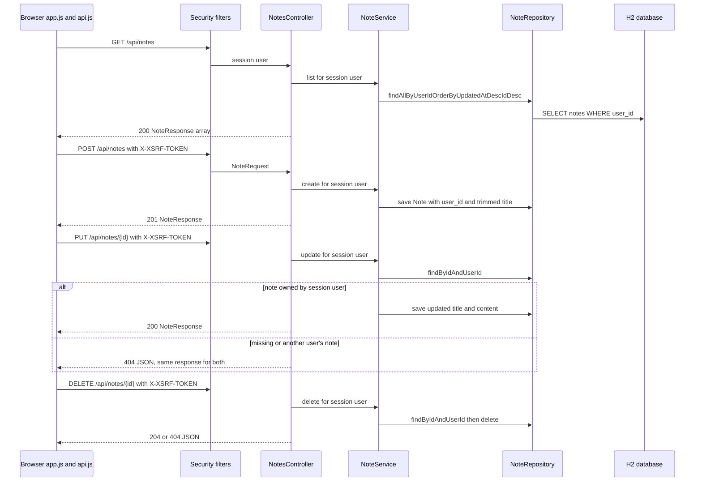

# Architecture

## Overview
SimpleNote (Jira SIMNOTE) is a single Spring Boot web application. It serves the static HTML, CSS, and vanilla JavaScript frontend from the same origin and exposes a JSON REST API under /api. Data is persisted in an H2 file database through Spring Data JPA. Authentication uses Spring Security with a server-side session and a signed remember-me cookie. The architectural style is a layered modular monolith: one deployable unit, packaged by layer (controller, service, repository, domain, DTO, security, config). The frontend uses classic script tags (api.js, then app.js) with no build step and no npm packages.

Rationale: one deployable with the frontend served from the same origin keeps session cookies simple and removes the need for CORS (CON-005, NFR-006). Layers keep business rules and ownership checks in services (NFR-014). Trade-off: H2 file mode allows one process to own the database file, so only one running instance is supported; no requirement asks for horizontal scaling.

Iteration: 6 (2026-11-15). Based on requirements iteration 8 (owner re-approval pending). This iteration replaces the iteration 4 browser-only LocalStorage design, which is superseded 2026-11-15 (history kept in the Decision Log). Iteration 4 decisions are kept in the Decision Log (superseded).

## Approval
Status: Approved (iteration 6). Explicit owner approval 2026-11-15. Based on requirements iteration 8 (approved 2026-11-15). The iteration 5 approval is superseded.
Approver and date: Lakshay Pahuja (project owner), 2026-11-16.

## Architectural Drivers
- Persistence and schema: FR-019, CON-007 (H2 file mode, Spring Data JPA, ddl-auto=update), FR-001, FR-004, FR-007 (stored title and password fields).
- Authentication and session: FR-002, FR-003, FR-022, CON-008, NFR-008 (session cookie attributes), FR-020 (BCrypt).
- CSRF and API protection: NFR-009 (403 without token), NFR-010 (H2 console disabled), NFR-007 (no secrets in responses).
- Ownership: FR-005, FR-014, FR-021, FR-015 (404 for other users' notes; 401 when logged out).
- Validation: NFR-011 (server-side Bean Validation is authoritative), FR-001, FR-004, FR-007, FR-013.
- API contract: CON-009, NFR-012 (status codes), NFR-013 (one error format), NFR-015 (DTOs, no entities).
- Structure and deployment: CON-005, NFR-006 (same-origin static frontend, mvn spring-boot:run, port 8080), CON-006 (Spring Boot 3.4.x, Java 21, Maven), NFR-014, NFR-021.
- Testing and observability: NFR-002, NFR-019, NFR-020 (JaCoCo, 80 percent target), NFR-017, NFR-018 (logging without credentials), NFR-003 (Chrome only).

## Component Diagram

Component responsibilities:
- Static frontend (src/main/resources/static): renders the logged-out and logged-in views, collects input, and calls /api. It holds no authoritative state or rules (NFR-011).
- Security filter chain (security package): authenticates the session or remember-me cookie, enforces CSRF tokens on state-changing requests, returns 401 for unauthenticated API calls and 403 for CSRF failures, and sets cookie attributes.
- Controllers (controller package): map HTTP to service calls, bind and validate DTOs, and return DTOs with status codes. They do not access repositories (NFR-014).
- ApiExceptionHandler (controller package): maps exceptions to the single error format and the status codes in NFR-012. It never returns stack traces or credentials (NFR-007).
- AuthService (service package): registration (PasswordPolicy, username normalization, duplicate check, BCrypt hashing) and login/logout support.
- NoteService (service package): note create, list, view, update, and delete. Every operation is scoped to the session user; the ownership check is authoritative (FR-021).
- PasswordPolicy and UsernameNormalizer (service package): single-purpose rule classes. PasswordPolicy is used by registration only (FR-001).
- Repositories (repository package): Spring Data JPA interfaces. Note queries always include user_id (FR-021).
- Domain entities (domain package): User and Note JPA entities. They are never returned from controllers (NFR-015).
- Config (config package and application.properties): session timeout, cookie attributes, H2 URL, console disabled, remember-me key (required, no generated default), Clock bean for timestamps.

## Layer and Package List
| Package (com.simplenote.*) | Contents | Responsibility | May depend on |
|----------------------------|----------|----------------|---------------|
| controller | AuthController, NotesController, ApiExceptionHandler | REST endpoints under /api, DTO binding, status mapping | service, dto |
| service | AuthService, NoteService, PasswordPolicy, UsernameNormalizer | Business rules, ownership checks, DTO mapping | repository, domain, dto |
| repository | UserRepository, NoteRepository | Spring Data JPA persistence; user_id filters on note queries | domain |
| domain | User, Note | JPA entities (no API exposure) | none |
| dto | RegisterRequest, LoginRequest, NoteRequest, UserResponse, NoteResponse, ApiErrorResponse (records) | API request and response shapes | none |
| security | SecurityConfig, SimpleNoteUserDetailsService, CSRF token-loading filter | Session, CSRF, remember-me, JSON 401 and 403 handling | service (user lookup via repository), config |
| config | SimpleNoteProperties (remember-me key), Clock bean | Typed configuration and startup validation | none |

Static resources (src/main/resources/static): index.html, styles.css, api.js, app.js.
Tests (src/test/java, mirroring the packages) and tests/dom/ (DOM check script, outside the Maven tree).

## Frontend Modules
- index.html: one page with a logged-out region (login and register forms) and a logged-in region (note list, editor). Loads styles.css, then api.js, then app.js as classic scripts in that fixed order. No type="module" and no inline event handlers.
- styles.css: responsive layout with flexbox or grid and media queries; no framework (NFR-001).
- api.js: a single global api object. Wraps fetch with credentials same-origin; sets Content-Type application/json; sends the X-XSRF-TOKEN header (read from the XSRF-TOKEN cookie) on POST, PUT, and DELETE; maps error bodies to a client error with status and message; calls a registered handler on any 401. Methods: me, register, login, logout, listNotes, getNote, createNote, updateNote, deleteNote.
- app.js: view state (logged out or logged in), rendering, and event binding. Runs the startup check (api.me), re-checks on window focus, and returns the user to the login view on any 401. Renders all user text with textContent, never innerHTML (XSS prevention). In the logged-out state it does not render the note list.

## Interfaces (REST API under /api)
All error responses use the ApiErrorResponse format in the Security Design section. Session cookies are set on login. State-changing requests (POST, PUT, DELETE) require the X-XSRF-TOKEN header (NFR-009).

| Method | Path | Auth | Request | Response | Status codes |
|--------|------|------|---------|----------|--------------|
| GET | /api/auth/me | Session (401 if none) | none | 200 UserResponse {username} | 200, 401 |
| POST | /api/auth/register | None (CSRF token) | RegisterRequest {username, password} | 201 UserResponse (no auto-login) | 201, 400, 403, 409 |
| POST | /api/auth/login | None (CSRF token) | LoginRequest {username, password} | 200 UserResponse; sets JSESSIONID and remember-me | 200, 400, 401, 403 |
| POST | /api/auth/logout | Session optional (CSRF token) | none | 204; session invalidated; cookies cleared | 204, 403 |
| GET | /api/notes | Session | none | 200 array of NoteResponse, most recently updated first | 200, 401 |
| POST | /api/notes | Session and CSRF | NoteRequest {title, content} | 201 NoteResponse | 201, 400, 401, 403 |
| GET | /api/notes/{id} | Session | none | 200 NoteResponse | 200, 401, 404 |
| PUT | /api/notes/{id} | Session and CSRF | NoteRequest {title, content} | 200 NoteResponse | 200, 400, 401, 403, 404 |
| DELETE | /api/notes/{id} | Session and CSRF | none | 204 | 204, 401, 403, 404 |

NoteResponse: {id, title, content, createdAt, updatedAt}. UserResponse: {username} (normalized). No response contains a password, password hash, session identifier, or stack trace (NFR-007).

## Data Model
H2 file database jdbc:h2:file:./data/simplenote, schema via ddl-auto=update (local single-user app, no migration tool).

Table users:
| Column | Type | Constraints | Notes |
|--------|------|-------------|-------|
| id | BIGINT | PK, identity | |
| username_normalized | VARCHAR(255) | NOT NULL, UNIQUE | trimmed and lowercased username (FR-013) |
| password_hash | VARCHAR(100) | NOT NULL | BCrypt hash (60 characters); never returned |
| created_at | TIMESTAMP (UTC) | NOT NULL | |

Table notes:
| Column | Type | Constraints | Notes |
|--------|------|-------------|-------|
| id | BIGINT | PK, identity | |
| user_id | BIGINT | NOT NULL, FK to users.id | owner; every query filters on it (FR-021) |
| title | VARCHAR(255) | NOT NULL | trimmed before storage; minimum 1 character (FR-004, FR-007) |
| content | VARCHAR(10000) | NOT NULL | may be empty; null stored as empty string; design limit 10,000 characters |
| created_at | TIMESTAMP (UTC) | NOT NULL | |
| updated_at | TIMESTAMP (UTC) | NOT NULL | set on create and update; drives list order |

Table persistent_logins (Spring JdbcTokenRepositoryImpl schema; DRQ-16 option A): series VARCHAR(64) PK; username VARCHAR(64) NOT NULL; token VARCHAR(64) NOT NULL; last_used TIMESTAMP NOT NULL. Logout deletes the row for the series.

Index: notes (user_id, updated_at). Delete is a hard delete (FR-010). BR-001: only title and content are note fields; id, user_id, and timestamps are storage fields.

## Security Design
- Authentication (FR-002, FR-022, CON-008): POST /api/auth/login verifies credentials through Spring Security's AuthenticationManager with SimpleNoteUserDetailsService (username normalized before lookup). On success the session id is changed, the security context is stored in the session, and the remember-me cookie is issued. Login does not re-check the password policy (Decision 6). Failed login returns 401 with the message "Invalid username or password."
- Session cookie (NFR-008): JSESSIONID with HttpOnly and SameSite=Lax (server.servlet.session.cookie.http-only=true, same-site=lax). Idle session timeout is 30 minutes. The Secure flag is not set for local http://localhost; it must be enabled for any HTTPS deployment.
- Remember-me (FR-022, DRQ-16 option A): Spring Security PersistentTokenBasedRememberMeServices with a JDBC token table (persistent_logins) in H2, cookie name remember-me, validity 7 days (604800 seconds), absolute from login. Tokens are stored server-side, so logout deletes them and a replayed cookie is rejected. The signature uses the key from simplenote.remember-me.key, which is loaded from the environment variable SIMPLENOTE_REMEMBER_ME_KEY with a documented placeholder in application.properties. The application refuses to start if the key is blank or shorter than 32 characters; no key is generated at startup. The cookie is HttpOnly and SameSite=Lax (a response header customization, verified by test). The token signature includes the stored password hash, so any future password change invalidates existing remember-me tokens.
- Logout (FR-003): POST /api/auth/logout invalidates the session, deletes the stored remember-me token (persistent_logins row), clears JSESSIONID and remember-me, and returns 204.
- CSRF (NFR-009): CookieCsrfTokenRepository.withHttpOnlyFalse() writes the XSRF-TOKEN cookie (HttpOnly false, so api.js can read it). Spring Security 6 SPA setup: use CsrfTokenRequestAttributeHandler with setCsrfRequestAttributeName(null) so the header value is compared as plain text, and add a small filter after the security filters that calls the CsrfToken getToken() method on every request so the cookie is written (Spring Security 6 defers token creation). Missing or invalid token returns 403 in the JSON format.
- Password (FR-001, FR-020): PasswordPolicy is the single class for the rule: minimum 8 characters, at least one letter (ASCII A-Z, a-z; Q-N9 proposed), at least one digit. It is used by registration only. Maximum 72 bytes is a technical BCrypt input limit, not a policy rule. Hashing uses BCryptPasswordEncoder (Spring default strength 10). Passwords are never logged or returned.
- Username (FR-013): trimmed, lowercased, stored as username_normalized; 3 to 32 characters after trim using only A-Z, a-z, 0-9, and underscore (requirements iteration 8, approved by owner 2026-11-16, Q-E11); empty after trim is 400; the unique constraint enforces uniqueness. A concurrent duplicate that passes the pre-check is caught as a constraint violation and returned as 409.
- Ownership (FR-005, FR-014, FR-021): NoteService takes the user id from the authenticated principal before each operation. Repository queries use findByIdAndUserId and findAllByUserIdOrderByUpdatedAtDescIdDesc. A missing note and another user's note return the same 404.
- Authentication required (FR-015, NFR-012): every /api/notes request without a valid session or remember-me returns 401 in the JSON format.
- Responses (NFR-007): no DTO has a password or hash field; server.error.include-stacktrace=never and include-message=never; validation messages name fields only and never echo password values.
- H2 console (NFR-010): spring.h2.console.enabled=false; a test asserts /h2-console is not served.
- Secrets (NFR-016): the committed remember-me key is a placeholder; data/ is git-ignored.
- Logging (NFR-017, NFR-018): SLF4J. Failed logins log at WARN with the normalized username and no password. Unhandled exceptions log at ERROR with the exception in the log only. No log line contains a password or hash.

## Error Format and Status Mapping
ApiErrorResponse (record): {timestamp (ISO-8601 UTC), status (integer), error (reason phrase), message (safe text), path}. This field set matches the Spring Boot default error body, so no other error shape exists (NFR-013).

| Condition | Status | Message |
|-----------|--------|---------|
| Bean Validation, PasswordPolicy, TrimmedSize, or malformed JSON | 400 | Field-level message, no echoed values |
| Bad login credentials | 401 | Invalid username or password. |
| No session or remember-me on protected endpoint | 401 | Authentication required. |
| Missing or invalid CSRF token | 403 | Invalid or missing CSRF token. |
| Note missing or owned by another user | 404 | Note not found. |
| Username already registered (case-insensitive) | 409 | Username is already registered. |
| Unhandled exception | 500 | An unexpected error occurred. (logged at ERROR) |

## Input Rules
- Username: required, trimmed, lowercased; 3 to 32 characters after trim; letters A-Z, a-z, digits, and underscore only (approved by owner 2026-11-16, Q-E11); empty after trim is 400. Column width VARCHAR(255) is unchanged.
- Password: minimum 8 characters, at least one ASCII letter (A-Z, a-z; Q-N9 proposed) and one digit (PasswordPolicy); maximum 72 bytes (BCrypt limit).
- Note title: trimmed; not blank; 1 to 255 characters after trimming (custom TrimmedSize constraint on the DTO, with @NotBlank). The trimmed value is stored (FR-004, FR-007). The 255 limit is owner-confirmed (2026-11-15).
- Note content: any text; null treated as empty; maximum 10,000 characters (owner answer recorded in requirements iteration 8; @Size on the DTO).
- Bean Validation on the DTOs is the server-side authority (NFR-011); client-side checks are usability only.

## Data Flows
Authentication and startup flows:

Note flows:

Narrative:
- Startup check: app.js calls GET /api/auth/me. A 200 response shows the notes view and loads the list; a 401 shows only the login and register views. The same check runs on window focus. The server ownership check remains the authoritative guard (replaces FR-018 client re-check).
- Register: the browser sends the username and password with the CSRF header. The server validates, normalizes the username, rejects duplicates with 409, hashes the password with BCrypt, and stores the user. Registration does not log the user in; the browser shows the login view after 201.
- Login: credentials are checked against the BCrypt hash. Success creates the session and remember-me cookie. Failure returns 401 and logs a WARN entry without the password.
- List, view, create, edit, delete: every request resolves the session user and passes it to NoteService. Note lookups by id include user_id, so another user's note returns 404. The list is ordered by updated_at descending (Decision 9).
- Logout: the server invalidates the session and clears both cookies; later note requests return 401.

## Testing Design
- Unit tests (JUnit 5, Mockito; no Spring context): PasswordPolicy (boundaries at 7 and 8 characters, letter-only, digit-only, 72-byte limit); UsernameNormalizer (trim, lowercase, blank rejected); TrimmedSize (whitespace-only, 1 and 255 boundaries, 256 rejected); NoteService ownership (repository called with session user id; another user's id yields not found).
- Web slice (@WebMvcTest with SecurityConfig imported; services mocked with @MockitoBean): request binding, DTO validation to 400, JSON error format for 400, 401, 403, 404, 409, and that controllers call only services.
- Integration (@SpringBootTest with MockMvc and an in-memory H2 test profile): register, login, logout, and note create, view, edit, delete; CSRF 403 without token; 401 without session and after logout; 404 for another user's note; 409 for case-insensitive duplicate; Set-Cookie attributes for JSESSIONID and remember-me (NFR-008); no password, hash, session id, or stack trace in any response (NFR-007); /h2-console not served (NFR-010); log capture asserts no password in log output (NFR-018).
- Coverage (NFR-019, NFR-020): JaCoCo prepare-agent and report goals are bound to the test phase, so mvn test writes the report to target/site/jacoco. Target is 80 percent line coverage on service and controller packages, measured in Verification; the build does not fail on it in this iteration.
- DOM check (Verification-stage task, script in tests/dom/): Node 22 built-in fetch and WebSocket drive headless Chrome started with --headless and --remote-debugging-port=9222 and a temporary user-data directory. No npm, no third-party framework (NFR-002, CON-005). Checks, with a unique username per run: register, login, create, edit, delete, logged-out block (login view only, no note list, GET /api/notes returns 401), and persistence after reload (created note still shown). Layout check at 375 px and 1280 px widths asserts no horizontal overflow (NFR-001). Non-zero exit code on any failure.
- Manual-only testing is not accepted (NFR-002).

## Deployment and Setup
- Run: mvn spring-boot:run from the project root; open http://localhost:8080 in Google Chrome (NFR-006). No file:// access.
- Test: mvn test (JUnit, MockMvc, JaCoCo report in target/site/jacoco). Test command documented in the README (NFR-021).
- DOM check: start the app, then run the Node 22 script in tests/dom/ (Chrome must be installed).
- Data: H2 file at ./data/simplenote.mv.db, created on first run; data/ is git-ignored.
- Configuration: SIMPLENOTE_REMEMBER_ME_KEY overrides the remember-me key placeholder; any shared deployment must set it.
- README (NFR-021) prerequisites: JDK 21 (or a compatible JDK after gate R-1), Apache Maven 3.10.0 or later, Node 22 (DOM check only), Google Chrome (DOM check only). JAVA_HOME must be set to the JDK installation directory (R-2). Commands: run, test, DOM check.
- Packaging: single executable jar from Spring Boot (spring-boot-maven-plugin).

## Technology Stack
| Layer | Choice | Rationale | Options Considered (Pros / Cons) | Driven By |
|-------|--------|-----------|-----------------------------------|-----------|
| Frontend markup and styling | HTML5 and CSS3 (static resources) | Required; served by Spring Boot, no build | Option A: vanilla HTML and CSS, pros no build, cons manual layout code / Option B: React with Vite, pros components, cons npm and build step (violates CON-005) | FR-012, NFR-001, CON-005 |
| Frontend scripting | Vanilla JavaScript, fetch API, classic script tags in fixed order | No framework or build; two modules are enough | Option A: classic scripts, pros simple fixed order, cons no import system / Option B: ES modules, pros native imports, cons not needed for two files; Option C: Vue, pros reactivity, cons build or CDN dependency | FR-012, CON-005, NFR-001 |
| Backend framework | Spring Boot 3.4.x (latest patch pinned in pom.xml in the first implementation task) | Owner-delegated 3.x line; mature Security, JPA, and validation integration | Option A: Spring Boot 3.4.x, pros stable and Boot-managed BOM, cons not latest line / Option B: Spring Boot 3.5.x, pros newer, cons less established for this design / Option C: Quarkus, pros fast start, cons weaker fit for Spring Security session model | CON-006, FR-022, NFR-014 |
| Language and runtime | Java 21 LTS (source and target release 21) | Owner-delegated LTS target | Option A: Java 21, pros LTS and Boot 3.4 support, cons none material / Option B: Java 17, pros wider support, cons older features / Option C: JDK 27 as target, pros matches machine, cons Spring Boot 3.4.x support on JDK 27 not verified (R-1) | CON-006, R-1 |
| Build | Apache Maven 3.10.0 | Owner-delegated; CON-006 requires Maven; verified version | Option A: Maven, pros standard for Boot, cons verbose XML / Option B: Gradle, pros faster builds, cons not required and extra DSL | CON-006, NFR-019, NFR-021 |
| Persistence | Spring Data JPA with Hibernate (Boot-managed) | Repository layer and entities with minimal SQL | Option A: Spring Data JPA, pros less boilerplate, cons ORM behaviour to understand / Option B: JdbcTemplate, pros explicit SQL, cons manual mapping / Option C: MyBatis, pros SQL control, cons extra mapping files | FR-019, CON-007, NFR-014 |
| Database | H2 in file mode (Boot-managed version) | Owner directive; file mode survives restarts | Option A: H2 file, pros embedded and zero install, cons single process owns the file / Option B: SQLite, pros file DB, cons not Boot default and weaker JPA support / Option C: PostgreSQL, pros production-grade, cons extra service violates the local H2 directive | FR-019, CON-007 |
| Schema management | Hibernate ddl-auto=update | Local single-user app; no migration tool needed | Option A: ddl-auto=update, pros no extra files, cons no versioned history / Option B: Flyway, pros versioned, cons extra dependency and scripts / Option C: startup SQL script, pros explicit, cons manual upkeep | FR-019, CON-007 |
| Security | Spring Security 6.x (Boot-managed) with server-side session | CON-008; session cookie and CSRF support | Option A: Spring Security session, pros built-in CSRF and remember-me, cons more configuration / Option B: JWT, pros stateless, cons logout needs revocation and CON-008 requires server session / Option C: custom filter, pros control, cons error-prone | FR-002, FR-003, FR-015, FR-022, NFR-008, NFR-009, CON-008 |
| Password hashing | BCrypt (BCryptPasswordEncoder, strength 10) | Owner-delegated BCrypt; salt is per hash | Option A: BCrypt, pros built-in in Spring Security, cons 72-byte input limit / Option B: Argon2, pros memory-hard, cons native library dependency / Option C: PBKDF2, pros JDK-based, cons more tuning | FR-020, CON-008 |
| Remember-me | Spring Security PersistentTokenBasedRememberMeServices, JDBC persistent_logins, 7-day cookie | Revocable on logout (DR-026 fix) | Chosen (DRQ-16 option A, owner 2026-11-15): persistent token table, revocable on logout, one extra table / Rejected: stateless TokenBasedRememberMeServices, not revocable before expiry | FR-002, FR-003, FR-022 |
| Validation | Bean Validation via Hibernate Validator (Boot starter) | Server-side authoritative validation | Option A: Bean Validation, pros declarative, cons custom constraint needed for trimmed title / Option B: manual checks, pros explicit, cons easy to miss rules | NFR-011, FR-001, FR-004, FR-007 |
| Logging | SLF4J with Logback (Boot default) | Standard logging, failed logins at WARN | Option A: Logback, pros default, cons none material / Option B: Log4j2, pros features, cons extra configuration | NFR-017, NFR-018 |
| Testing | JUnit 5, Spring Boot Test, MockMvc, Mockito (Boot-managed) | Owner-delegated; mvn test | Option A: JUnit 5, pros Boot default, cons none material / Option B: TestNG, pros features, cons not Boot default / Option C: Testcontainers, pros production DB, cons needs Docker and H2 is the chosen DB | NFR-002, NFR-019 |
| Coverage | JaCoCo 0.8.x (version pinned in pom.xml, supports Java 21) | Owner-delegated; line and branch report | Option A: JaCoCo, pros standard Maven plugin, cons none material / Option B: Cobertura, pros legacy support, cons stale / Option C: Clover, pros features, cons commercial | NFR-019, NFR-020 |
| DOM check | Google Chrome (headless, remote debugging) with Node 22 built-in WebSocket and fetch | No npm and no third-party framework (CON-005, NFR-002) | Option A: raw DevTools protocol from Node 22, pros no npm, cons hand-written CDP calls / Option B: Puppeteer, pros API, cons npm dependency / Option C: Selenium Java, pros standard, cons extra test dependency and driver management | NFR-002, NFR-001, NFR-003 |
| Node.js | Node 22 (reported v22.18.0 by the orchestrator, 2026-11-15; not re-verified in this pass) | Runtime for DOM check only | Option A: Node 22, pros built-in WebSocket and fetch, cons none for this use / Option B: Node 20, cons no stable built-in WebSocket | NFR-002 |
| Hosting | Local machine: mvn spring-boot:run on port 8080 | Owner-delegated; no hosting requirement | Option A: local run, pros simplest, cons single user / Option B: Docker image, pros reproducible, cons extra tooling not required / Option C: cloud PaaS, pros availability, cons out of scope | NFR-006, NFR-021 |

## Cross-Cutting Concerns
- Security: session cookie, CSRF, BCrypt, ownership, no secrets in responses or logs (NFR-007 to NFR-010, NFR-016, NFR-018). Gaps accepted: Secure cookie flag is off for localhost HTTP; enable for HTTPS deployments.
- Scalability and limits: single-user local app with one H2 file owner; note list is not paginated (no requirement); content limit 10,000 characters and title limit 255 characters bound response size. No performance target exists (Q-N4).
- Availability: no high-availability requirement; a single process runs locally. Session and remember-me keys must persist across restarts for remember-me to survive them.
- Observability: SLF4J logs for failed logins and unhandled errors without credentials (NFR-017, NFR-018).
- Maintainability: layered packages and DTOs (NFR-014, NFR-015). Layer rule is confirmed by code review in Verification.
- Deployment: mvn spring-boot:run; README with prerequisites and commands (NFR-006, NFR-021).
- Accessibility: no standard set (Q-N3); the layout uses semantic HTML form labels as a basic practice.

## Requirement Traceability
Active items in requirements iteration 7. Superseded items are listed at the end.

| ID | Status (requirements) | Component or design element | Verification |
|----|-----------------------|-----------------------------|--------------|
| FR-001 | Approved (requirements iteration 8, owner 2026-11-16) | AuthService, PasswordPolicy (ASCII letter), RegisterRequest, register form | Unit (PasswordPolicy), integration (register) |
| FR-002 | Approved | AuthController login, AuthenticationManager, SimpleNoteUserDetailsService, session and remember-me | Integration login, Set-Cookie test |
| FR-003 | Out of scope (owner decision 2026-11-16, iteration 8) | AuthController logout, SecurityConfig logout handler, app.js logout button | Integration logout, DOM check |
| FR-004 | Approved (requirements iteration 8, owner 2026-11-16) | NoteService create, NoteRequest, TrimmedSize, notes table | Unit (TrimmedSize), integration create |
| FR-005 | Approved | NoteService user_id from session user, notes.user_id | Unit ownership, integration |
| FR-006 | Approved | NoteService list, findAllByUserIdOrderByUpdatedAtDescIdDesc, app.js list | Integration list, DOM check |
| FR-007 | Approved (requirements iteration 8, owner 2026-11-16) | NoteService update, NoteRequest, TrimmedSize | Unit, integration edit |
| FR-008 | Out of scope (owner decision 2026-11-16, iteration 8) | NoteService update returns NoteResponse; app.js re-renders from response | Integration edit, DOM check |
| FR-009 | Out of scope (owner decision 2026-11-16, iteration 8) | NoteService delete, DELETE endpoint, app.js delete button (confirmation per Q-N1) | Integration delete, DOM check |
| FR-010 | Approved | Hard delete through NoteRepository; list excludes row | Integration delete then list, DOM check |
| FR-012 | Out of scope (owner decision 2026-11-16, iteration 8) | Static frontend: index.html, styles.css, api.js, app.js | DOM check |
| FR-013 | Approved (requirements iteration 8, owner 2026-11-16) | UsernameNormalizer, username format check, unique username_normalized, duplicate to 409 | Unit normalization, integration 409 |
| FR-014 | Approved | Same as FR-005 and FR-006 (ownership in NoteService) | Integration cross-user tests |
| FR-015 | Approved (iteration 7) | SecurityConfig protects /api/notes, JSON 401 entry point; app.js logged-out view | Integration 401, DOM check logged-out block |
| FR-019 | Approved (iteration 7) | H2 file database, JPA repositories, ddl-auto=update | Integration tests on H2 |
| FR-020 | Approved (iteration 7) | BCryptPasswordEncoder in AuthService | Unit or integration: stored hash is not the password |
| FR-021 | Approved (iteration 7) | NoteService ownership, findByIdAndUserId, 404 | Unit and integration cross-user 404 |
| FR-022 | Approved (iteration 7) | Session timeout 30 minutes, remember-me 7 days, api.me startup check | Integration remember-me cookie, DOM check reload |
| NFR-001 | Approved | styles.css responsive layout | DOM check layout at 375 px and 1280 px |
| NFR-002 | Approved (iteration 7) | Testing design: JUnit, MockMvc, DOM check | mvn test and DOM check run (Verification) |
| NFR-003 | Approved | Chrome only for DOM check and manual target | DOM check uses Chrome |
| NFR-006 | Approved (iteration 7) | mvn spring-boot:run, port 8080 | Run check in Verification |
| NFR-007 | Approved (iteration 7) | DTO without secret fields; error handler; no stack trace | Integration response-body assertions |
| NFR-008 | Approved (iteration 7) | Session cookie HttpOnly and SameSite=Lax; remember-me same | Integration Set-Cookie test |
| NFR-009 | Approved (iteration 7) | CookieCsrfTokenRepository, CSRF token-loading filter, 403 JSON | Integration 403 test |
| NFR-010 | Approved (iteration 7) | spring.h2.console.enabled=false | Integration /h2-console test |
| NFR-011 | Approved (iteration 7) | Bean Validation on DTOs; PasswordPolicy in service; 400 mapping | Web slice and integration 400 tests |
| NFR-012 | Approved (iteration 7) | Status mapping table; ApiExceptionHandler; entry point; CSRF handler | Web slice and integration tests |
| NFR-013 | Approved (iteration 7) | ApiErrorResponse record | Web slice format test |
| NFR-014 | Approved (iteration 7) | Package layers; controllers depend on services only | Code review (Verification) and web slice mocks |
| NFR-015 | Approved (iteration 7) | DTO records; services map entities to DTOs | Integration JSON shape test |
| NFR-016 | Approved (iteration 7) | Placeholder key only; env var override; data/ git-ignored | Repository review (Verification) |
| NFR-017 | Approved (iteration 7) | SLF4J WARN on failed login; ERROR on unhandled exception | Integration log capture |
| NFR-018 | Approved (iteration 7) | Logging rules; no password or hash in logs | Log capture test and log review |
| NFR-019 | Approved (iteration 7) | JaCoCo report bound to test phase | mvn test produces report |
| NFR-020 | Approved (iteration 7) | 80 percent line target on service and controller packages | JaCoCo measurement in Verification |
| NFR-021 | Approved (iteration 7) | README with prerequisites, run, test, JAVA_HOME | Document review (Verification) |
| BR-001 | Approved (iteration 8, owner 2026-11-16) | Note entity has only title and content as user fields | Unit and integration DTO shape |
| CON-003 | Approved (iteration 8, owner 2026-11-16) | No extra features: no clear-all, delete-account, or admin | Review (Verification) |
| CON-005 | Approved (iteration 7) | Static resources, same origin, no npm, no build | Repository review; DOM check |
| CON-006 | Approved (iteration 7) | Spring Boot 3.4.x, Java 21, Maven; R-1 gate | Build gate (R-1) |
| CON-007 | Approved (iteration 7) | H2 file mode, Spring Data JPA | Integration tests |
| CON-008 | Approved (iteration 7) | Spring Security, BCrypt, server-side session | Integration tests |
| CON-009 | Approved (iteration 7) | REST JSON under /api | Web slice and integration tests |

Superseded (not designed): FR-011, FR-016, FR-017, FR-018 (superseded in iteration 7; replaced by FR-019 to FR-021). NFR-004, NFR-005 (superseded; replaced by NFR-006 to NFR-010). CON-001, CON-002, CON-004 (superseded; replaced by CON-005 to CON-007). Q-E8 closed, not applicable.

## Risks and Gates
| ID | Item | Gate or mitigation | Stage |
|----|------|--------------------|-------|
| R-1 | Spring Boot 3.4.x on JDK 27 (machine JDK; target Java 21) | Build gate in the first implementation task: run mvn -v and mvn test. If the build fails, install JDK 21, set JAVA_HOME to it, and rebuild. Java release stays 21 either way. | First implementation task |
| R-2 | JAVA_HOME not set on the verified environment | Documented as setup prerequisite in the README; verify that mvn -v reports the JDK used after setup | Implementation and Verification |
| R-3 | Node 22 version (reported v22.18.0) | Run node -v during Verification and record the result; the DOM check requires Node 22 | Verification |
| R-4 | Coverage target 80 percent (NFR-020) | Measure with JaCoCo on service and controller packages; target not enforced by build in this iteration | Verification |
| R-5 | H2 file database locked by one process | Single running instance is supported; a second start fails on the lock | Accepted design limit |
| R-6 | BCrypt 72-byte input limit | Passwords over 72 bytes are rejected with 400 (design limit, not a policy rule) | Implementation |
| R-7 | Remember-me key placeholder committed in application.properties | Placeholder only (NFR-016); any shared deployment must set SIMPLENOTE_REMEMBER_ME_KEY | Deployment |
| R-8 | Secure cookie flag off on http://localhost | Enable Secure for HTTPS deployments | Deployment |

## Open Questions
No open architecture items. Requirement questions open that affect this design: Q-E11 (title maximum, username format) and Q-N9 (password letter definition). Verification-stage checks: R-1 build gate, R-3 Node version check, R-4 coverage measurement, and the DOM check run.

Nonessential requirement questions (unchanged; not decided here):
- [ ] Q-N1: delete confirmation prompt (FR-009)
- [ ] Q-N3: accessibility standard (NFR gap)
- [ ] Q-N4: performance targets (NFR gap)
- [ ] Q-N5: full-storage behaviour (superseded LocalStorage context; for owner review)
- [ ] Q-N6: issue links, subtasks, comments, attachments in Jira (import coverage)
- [ ] Q-N7: intended characters in SIMNOTE-1 and SIMNOTE-7 (source inventory)
- [ ] Q-N8: viewport sizes and devices (NFR-001)
- [x] Q-N2: note order (closed in this architecture as a design default: most recently updated first; requirements file not edited)

## Decision Log

### Iteration 6 (2026-11-15)
1. 2026-11-15: Requirements iteration 8 applied (review items F-M1, F-M2, N-L1). Iteration 5 approval no longer applies; status Draft pending design review and owner re-approval. Traces: FR-001, FR-004, FR-007, FR-013.
2. 2026-11-15: Username format added: 3 to 32 characters after trim, A-Z, a-z, 0-9, underscore, enforced by Bean Validation on RegisterRequest after UsernameNormalizer trims. Proposed pending Q-E11. Rationale: FR-013 iteration 8. Trade-off: stricter than the previous no-format rule. Traces: FR-013, NFR-011.
3. 2026-11-15: PasswordPolicy letter is ASCII A-Z and a-z only. Proposed pending Q-N9. Rationale: FR-001 iteration 8. Trade-off: non-ASCII letters do not satisfy the rule. Traces: FR-001, NFR-011.
4. 2026-11-15: Title maximum 255 kept as the design value, pending Q-E11; content maximum 10,000 per owner answer. Traces: FR-004, FR-007.

### Iteration 5 (2026-11-15)
1. 2026-11-15: Layers: package by layer under one Spring Boot application (controller, service, repository, domain, dto, security, config); static frontend under src/main/resources/static. Rationale: one deployable and same-origin serving. Trade-off: one process only. Traces: CON-005, CON-009, NFR-014, NFR-015, NFR-006.
2. 2026-11-15: Frontend: vanilla JavaScript, classic script tags in order api.js then app.js, fetch with credentials same-origin, no framework and no build. Rationale: CON-005 and the no-build rule. Trade-off: manual rendering code. Traces: FR-012, CON-005, NFR-001.
3. 2026-11-15: Backend: Spring Boot 3.4.x, Java 21 source and target, Maven; Spring Web, Spring Data JPA, Spring Security, Bean Validation, H2 file mode, JUnit 5, Spring Boot Test, MockMvc, JaCoCo. R-1 is a build gate for the first implementation task; fallback is JDK 21 with JAVA_HOME. JAVA_HOME is a README prerequisite. Rationale: CON-006. Trade-off: JDK 27 compatibility unverified until the gate runs. Traces: CON-006, NFR-021.
4. 2026-11-15: Database: H2 file URL jdbc:h2:file:./data/simplenote; H2 console disabled; spring.jpa.hibernate.ddl-auto=update; tables users and notes as in Data Model; title stored trimmed. Rationale: local single-user app; no migration tool. Trade-off: no versioned schema history. Traces: FR-019, CON-007, NFR-010.
5. 2026-11-15: Auth: form-less JSON login at POST /api/auth/login with a server session; JSESSIONID HttpOnly and SameSite=Lax; idle timeout 30 minutes; remember-me cookie of 7 days (Spring PersistentTokenBasedRememberMeServices, JDBC persistent_logins table); logout via POST /api/auth/logout deletes the stored token and clears session and remember-me. Rationale: FR-002, FR-003, FR-022 require server-side revocation (DRQ-16 option A). Trade-off: one extra table. Traces: FR-002, FR-003, FR-022, CON-008, NFR-008, NFR-016.
6. 2026-11-15: Password policy: minimum 8 characters, at least one letter and one digit, enforced in PasswordPolicy for registration only; login does not re-check. Maximum 72 bytes as a BCrypt technical limit. Rationale: FR-001 and FR-020. Trade-off: 72-byte limit is a technical limit, flagged for owner visibility. Traces: FR-001, FR-020, NFR-011.
7. 2026-11-15: Username trimmed and lowercased to username_normalized, unique; empty after trim is 400; duplicate is 409 including concurrent insert. Rationale: FR-013 carry-over rule. Trade-off: display casing is not kept. Traces: FR-013, NFR-012.
8. 2026-11-15: CSRF: CookieCsrfTokenRepository with XSRF-TOKEN (HttpOnly false); CsrfTokenRequestAttributeHandler with plain header comparison and a token-loading filter for SPA use; api.js sends X-XSRF-TOKEN. Rationale: NFR-009 with a SPA. Trade-off: extra filter and handler configuration. Traces: NFR-009, CON-005.
9. 2026-11-15: Notes API: GET /api/notes, POST /api/notes, GET, PUT, DELETE /api/notes/{id}; ownership enforced in NoteService; queries include user_id; title 1 to 255 after trim; content up to 10,000 characters (design limit, null as empty); ordering most recently updated first with id as tie-break (closes Q-N2 as a design default; requirement not changed). Rationale: FR-005, FR-006, FR-021. Trade-off: no pagination. Traces: FR-004, FR-006, FR-007, FR-021, BR-001.
10. 2026-11-15: Error format: ApiErrorResponse {timestamp, status, error, message, path}; no stack traces or password data; 400, 401, 403, 404, 409 per NFR-012. Rationale: NFR-007, NFR-012, NFR-013. Trade-off: field set matches Spring Boot default, so no custom shape. Traces: NFR-007, NFR-012, NFR-013.
11. 2026-11-15: Logging: SLF4J; failed logins WARN, unhandled errors ERROR; no credentials logged. Rationale: NFR-017, NFR-018. Trade-off: usernames appear in WARN logs (not credentials). Traces: NFR-017, NFR-018.
12. 2026-11-15: Session and cross-tab: one server session covers all tabs; app.js checks GET /api/auth/me on load and window focus; any 401 returns to login view; server ownership check is authoritative. Rationale: replaces FR-018 client check. Trade-off: check depends on focus events. Traces: FR-022, FR-021.
13. 2026-11-15: Logged-out state: only login and register views; note list not rendered; note endpoints return 401 without session. Rationale: FR-015. Trade-off: none material. Traces: FR-015, NFR-012.
14. 2026-11-15: Clear-all data is not part of this design (FR-017 superseded; CON-003). Rationale: no extra features. Trade-off: none. Traces: CON-003.
15. 2026-11-15: Testing: JUnit 5 unit tests; @WebMvcTest and MockMvc for controllers and error mapping; @SpringBootTest with H2 for repository and security integration; JaCoCo report in the test phase so mvn test produces it (NFR-019; the owner text names mvn verify, but NFR-019 requires mvn test); DOM check with Node 22 built-in WebSocket and headless Chrome under tests/dom/ as a Verification-stage task. Traces: NFR-002, NFR-019, NFR-020.
16. 2026-11-15: Startup and setup: mvn spring-boot:run; http://localhost:8080; no file://; README with prerequisites (JDK 21 or compatible, Maven, Node 22 for DOM check, Chrome), run, test, and JAVA_HOME instructions. Traces: NFR-006, NFR-021, CON-006.
17. 2026-11-15: Coverage: NFR-020 80 percent line target on service and controller packages is the design target, confirmed by owner 2026-11-15, measured in Verification, not enforced by build. Traces: NFR-020.
18. 2026-11-15: Registration does not log the user in; the browser shows the login view after 201. Rationale: keeps login as the only session-creating operation. Trade-off: one extra step for the user. Traces: FR-001, FR-002.
19. 2026-11-15: Iteration 5 supersedes iteration 4 and is based on requirements iteration 7. Status Draft pending design review and owner approval. Traces: all active FR, NFR, CON.

### Iteration 4 (2026-11-14), superseded 2026-11-15
Superseded 2026-11-15 by iteration 5 (Spring Boot and H2). Kept as history. Iteration 4 decisions (browser-only design): LocalStorage storage; SHA-256 password hashing via Web Crypto with no salt (DRQ-06); headless Chrome --dump-dom DOM path (DRQ-07); invalid session treated as logged out and corrupt data blocked with clear-all as recovery (DRQ-08); username normalization (DRQ-09); clear-all confirmation and removal order (DRQ-10); on-screen warning (FR-016); cross-tab session isolation (FR-018); no ES modules because of file:// (NFR-005). Requirements that carried these decisions are superseded in requirements iteration 7 (FR-011, FR-016, FR-017, FR-018, NFR-004, NFR-005, CON-001, CON-002, CON-004).
